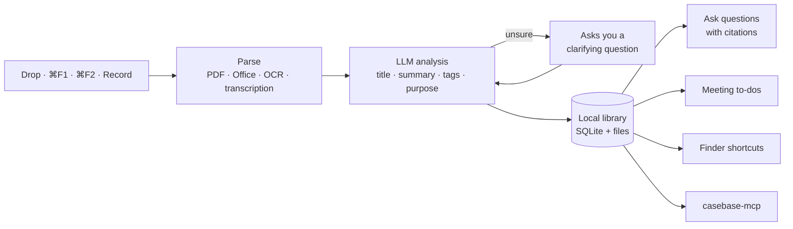

# casebase

[简体中文](README.zh-CN.md)

**Save anything in one move. casebase reads it, files it, and answers from it later.**

casebase lives in your Mac's notch. Drop in a file, press a hotkey on some text or a screenshot, or record a meeting. It figures out what the material is, organizes it on your Mac, and lets you ask questions about everything you have saved, with sources.

## What casebase does for you

**Catches material the moment it shows up.**
A file in a chat, a paragraph on a web page, a chart on screen. Drag it to the notch, or press `⌘F1` for selected text and `⌘F2` for a screenshot. No app to switch to, no folder to choose.

**Reads and files it for you.**
PDFs, Word/Excel/PowerPoint, images, audio, text and whole folders are parsed (with OCR for images). An LLM gives each item a title, summary, key snippets, tags and a purpose, then files it into a matching folder. When it isn't sure what something is for, it asks you a short question instead of guessing.

**Finds it again in Finder, too.**
Every record also appears as a shortcut under `~/Documents/Casebase 标签入口/<category>`, with a Finder tag, so you can browse by topic without opening the app.

**Answers from your own material.**
Ask a question and casebase searches your library, pulls the relevant passages, and answers with citations you can open. Saving the same file twice is detected and merged.

**Turns meetings into notes and to-dos.**
Start a recording from the notch and keep working. When you finish, the audio and transcript are saved as one record, and suggested action items wait for you to accept them as to-dos.

**Keeps your to-dos moving.**
To-dos have due dates and filters, and casebase can break a vague task into concrete subtasks.

**Works with your AI tools.**
The bundled `casebase-mcp` server lets Claude, Codex and other MCP clients search your records and read or update your to-dos.

## How it works



- **Local first.** The database (SQLite with full-text search) and your files stay in `~/Library/Application Support/casebase`. Content is sent only to the model provider you configure.
- **Models.** DeepSeek handles analysis, answers, and image/PDF understanding. A Google API key optionally adds Gemini embeddings for semantic search; without it, search falls back to full-text.
- **Transcription.** Meetings are transcribed by a local oMLX server, so audio doesn't leave your Mac.

## What you need to do

1. **Install.** Download `Casebase-<version>-arm64.dmg` from [Releases](https://github.com/Raozhu/casebase/releases) and drag `casebase.app` into Applications. The app isn't notarized yet, so on first launch open **System Settings → Privacy & Security** and click **Open Anyway**.
2. **Add a DeepSeek API key.** Hover the notch, open **Settings**, and paste the key.
3. **Start saving.** Drag something onto the notch, or try `⌘F1` / `⌘F2`. Grant each permission when macOS asks.

That's it. Optional extras:

- Meeting transcription: run an oMLX server locally (see [Configuration](#configuration)).
- Semantic search: add a Google API key in settings.
- AI tools: download `casebase-mcp` from Releases and add it to your MCP client.

Requires macOS 14 or later on Apple Silicon.

## Everyday use

| You want to | Do this |
|---|---|
| Save files, images, PDFs, audio, folders | Drag them onto the notch |
| Save the text you have selected | `⌘F1` |
| Take and save a screenshot | `⌘F2` |
| Record a meeting | Hover the notch → **Record**, set the number of speakers and an optional topic |
| Look through what you saved | Hover the notch → **View data** |
| Ask a question across everything you saved | Hover the notch → **Explore** |
| Check and manage to-dos | Hover the notch → **To-do** |
| Open the round table (optional) | `⌘F4` |

Hotkeys can be changed in settings. Recording keeps running while you use other features.

## Configuration

Settings live in `~/Library/Application Support/casebase/.env`. Keys entered in the app are written there.

| Variable | Purpose |
|---|---|
| `DEEPSEEK_API_KEY` | Required. Analysis, answers, image/PDF understanding |
| `CASEBASE_ANALYSIS_MODEL`, `CASEBASE_ANSWER_MODEL` | Model names, default `deepseek-flash` |
| `CASEBASE_GOOGLE_API_KEY` | Optional. Gemini embeddings for semantic search |
| `CASEBASE_STORAGE_ROOT` | Optional. Where the library lives, default `~/Library/Application Support/casebase` |

**Meeting transcription** uses a local oMLX server (OpenAI-compatible, model `VibeVoice-ASR-4bit`) configured in `~/.omlx/settings.json`. Without it, recording still works but no transcript is produced.

**Round table** (`⌘F4`) is an optional companion: a local multi-agent group chat started from `KNIGHTS_HOME` on port 3721, whose memories are imported into casebase automatically. Set `KNIGHTS_AUTOSTART=0` to turn it off.

## MCP server

`casebase-mcp` is a stdio MCP server over the same local library.

| Tool | What it does |
|---|---|
| `casebase_list_records`, `casebase_search_records`, `casebase_get_record` | Browse and search saved records |
| `casebase_list_todos`, `casebase_get_todo` | Read to-dos |
| `casebase_create_todo`, `casebase_update_todo` | Create and update to-dos |

```json
{
  "mcpServers": {
    "casebase": { "command": "/path/to/casebase-mcp" }
  }
}
```

## Permissions

casebase asks for each permission only when you first use the feature that needs it:

- Accessibility: read the selected text (`⌘F1`)
- Screen Recording: take screenshots (`⌘F2`)
- Microphone: record meetings

## Build from source

Open `casebase.xcodeproj` in Xcode 16 or later and run the `casebase` scheme. The `casebase-mcp` scheme builds the MCP server.

## License

[GPL-3.0](LICENSE)
