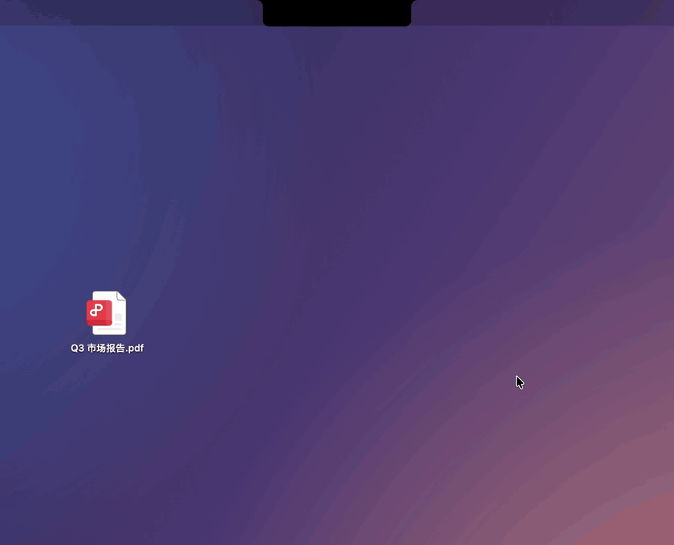
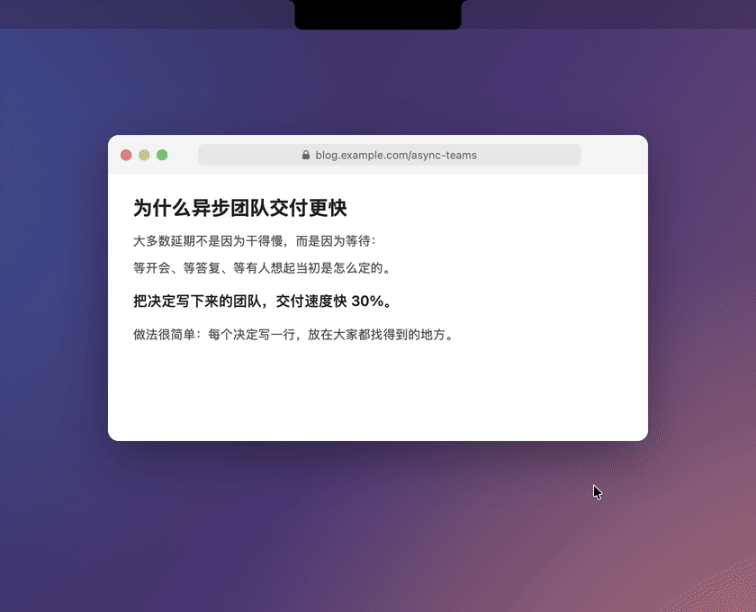
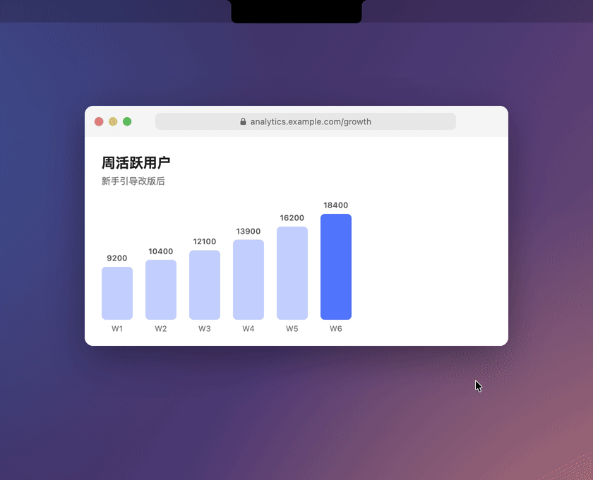
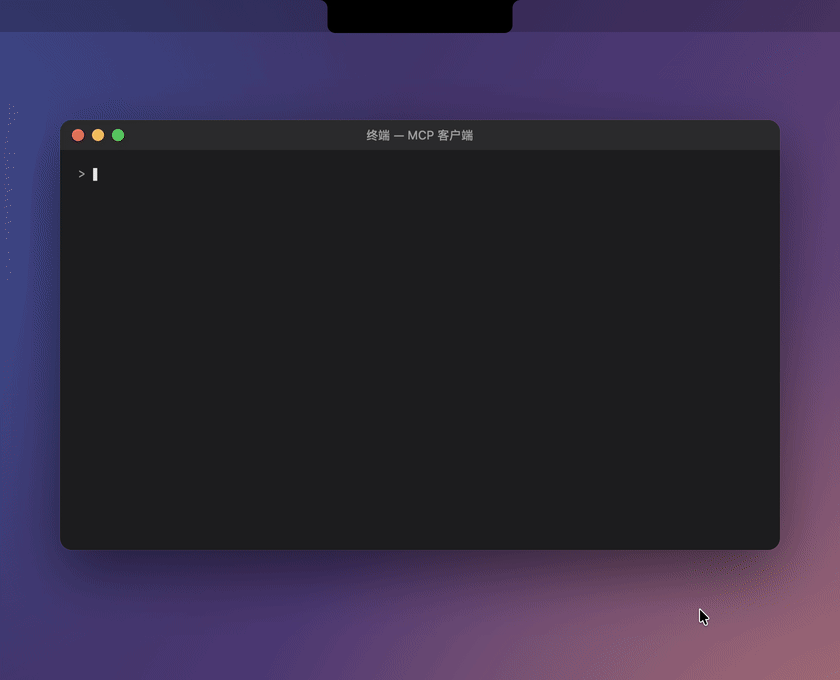

# casebase

[English](README.md)

casebase 是一个常驻在 Mac 刘海区域的应用。工作中遇到的文件、截图、文字和会议，都可以存进 casebase，之后直接提问，它会根据这些资料回答，并标出出处。

工作资料很少集中出现在一个地方。同事在聊天里发来一份 PDF，要用的图表在某个数据看板上，一个决定是在会议进行到一半时定下的。这些东西大多散落在下载文件夹、桌面和聊天记录里。一周后写复盘或跟进事情时，已经想不起放在哪里，也记不清当时具体怎么说的。

用 casebase，每样东西一秒钟就能存下，不用先想该放哪个文件夹。它会读懂内容、自动归类，之后你直接问它就能找回来。

## 看看它怎么用

### 保存文件


把文件拖到刘海上。casebase 会读取内容，写好标题、摘要和标签，并归好类。

### 按 ⌘F1 保存选中的文字


在任何地方选中文字按 `⌘F1`，会连同来源的应用和窗口一起保存。

### 按 ⌘F2 保存屏幕的一部分


按 `⌘F2` 框选需要的区域，截图会像其他图片一样被读取和整理。

### 对存过的资料提问


回答来自你自己的资料，并列出用到的来源。

### 把会议变成待办


会议里整理出的行动项由你确认后，才会进入「待办」。

### 把资料带到圆桌讨论


「带到圆桌」会打开可选的 12 Knights 圆桌，并带上这份资料，让几位 AI 成员一起看。

### 在 AI 工具里使用 casebase


通过 `casebase-mcp`，Claude Code、Codex 等 MCP 客户端可以搜索你的资料、添加待办。

这些演示由 app 自己的界面代码和一份隔离的演示资料库渲染而成，做法见 [tools/readme-demos](tools/readme-demos)。

## 可以用来做什么

**开会。** 在刘海里开始录音，然后继续做手上的事。会议结束后，你会拿到转写文本和一份行动项清单，会上提到的负责人和时间也一并标出，属于你的点一下就能加进待办。

**做用户访谈。** 访谈录音、笔记和截图随手存进来。写总结之前问一句「用户对价格怎么看？」，回答里会链接到每一场相关的访谈。

**写报告、做复盘。** 平时把同事发来的 PDF、看板上的图表、文章里的一段话顺手存下。它们会被自动分到不同的文件夹里，等你坐下来写报告时，材料已经整理好了。

**找回以前的决定。** 问「发布定价最后是怎么定的？」，casebase 会根据当时那场会议回答，并引用关键的原话。

**给 AI 工具提供上下文。** 把 Claude Code、Codex 或其他 MCP 客户端接入 casebase，它们就能查你的笔记和会议结论，也能帮你添加待办。

## 它是怎么工作的

**一个动作完成保存。** 把文件、文件夹、图片、PDF 或音频拖到刘海上；选中文字按 `⌘F1`；按 `⌘F2` 框选屏幕上的一块区域。

**casebase 会读懂你存的内容。** 它能解析 PDF、Word、Excel、PowerPoint、图片（含 OCR 文字识别）、音频和整个文件夹。大模型会为每份资料写标题、摘要、要点和标签，并按用途归类。拿不准用途时，它会问你一个简短的问题，而不是自己猜。重复保存同一个文件会被识别出来。

**跨所有资料提问。** 回答基于你存过的资料，并列出用到的来源，点开就能看原件。默认使用全文检索；填了 Google API Key 后可以启用语义检索。

**会议直接变成待办。** 录音在你的 Mac 上由本地 oMLX 服务转写。之后 casebase 会整理出行动项，附上负责人、截止时间和出处原话，由你确认后再加入待办。

**数据留在你的 Mac 上。** 资料库是一个 SQLite 数据库加上原始文件，存放在 `~/Library/Application Support/casebase`。每条资料还会出现在访达的 `~/Documents/Casebase 标签入口` 里，按分类放好并打上标签。内容只会发送给你自己配置的模型服务。

**能接入你的 AI 工具。** 附带的 `casebase-mcp` 服务让 MCP 客户端可以搜索你的资料，读取、新建和修改待办。

## 开始使用

1. 从 [Releases](https://github.com/Raozhu/casebase/releases) 下载 `Casebase-<版本号>-arm64.dmg`，把 `casebase.app` 拖进「应用程序」。应用暂未经过 Apple 公证，第一次打开时到「系统设置 → 隐私与安全性」里点「仍要打开」。
2. 鼠标移到刘海上，打开「设置」，粘贴 DeepSeek API Key。
3. 拖一个文件到刘海上，或者选中一段文字按 `⌘F1`。每个功能第一次使用时，macOS 会请求对应的权限。

需要 macOS 14 及以上、Apple 芯片的 Mac。

按需开启：运行 oMLX 服务以转写会议；填入 Google API Key 以启用语义检索；从 Releases 下载 `casebase-mcp` 接入你的 AI 工具。

## 参考

### 快捷键与菜单

| 想做的事 | 操作 |
|---|---|
| 保存文件、图片、PDF、音频、文件夹 | 拖到刘海上 |
| 保存选中的文字 | `⌘F1` |
| 框选屏幕区域并保存 | `⌘F2` |
| 会议录音 | 鼠标移到刘海上 → **录音** |
| 翻看存过的资料 | 鼠标移到刘海上 → **数据** |
| 提问 | 鼠标移到刘海上 → **探索** |
| 查看待办 | 鼠标移到刘海上 → **待办** |
| 打开圆桌（可选） | `⌘F4` |

快捷键可以在设置里修改。录音时切换到其他功能不会中断。

### 配置

配置保存在 `~/Library/Application Support/casebase/.env`，在应用里填写的 Key 也会写到这里。

| 变量 | 用途 |
|---|---|
| `DEEPSEEK_API_KEY` | 必填。资料分析、问答、图片和 PDF 理解 |
| `CASEBASE_ANALYSIS_MODEL`、`CASEBASE_ANSWER_MODEL` | 模型名，默认 `deepseek-flash` |
| `CASEBASE_GOOGLE_API_KEY` | 选填。启用 Gemini 向量语义检索 |
| `CASEBASE_STORAGE_ROOT` | 选填。资料库的存放位置 |

会议转写使用本地 oMLX 服务（兼容 OpenAI 接口，模型 `VibeVoice-ASR-4bit`），配置在 `~/.omlx/settings.json`。没有它时录音会照常保存，只是不转写。

圆桌（`⌘F4`）是可选的本地多智能体群聊服务，从 `KNIGHTS_HOME` 启动，端口 3721，它产生的记录会自动导入 casebase。设置 `KNIGHTS_AUTOSTART=0` 可以关闭。

### MCP 服务

`casebase-mcp` 是一个 stdio 方式的 MCP 服务，读取同一个本地资料库。

| 工具 | 作用 |
|---|---|
| `casebase_list_records`、`casebase_search_records`、`casebase_get_record` | 浏览和搜索资料 |
| `casebase_list_todos`、`casebase_get_todo` | 读取待办 |
| `casebase_create_todo`、`casebase_update_todo` | 新建和修改待办 |

```json
{
  "mcpServers": {
    "casebase": { "command": "/path/to/casebase-mcp" }
  }
}
```

### 权限

- 辅助功能：读取选中的文字（`⌘F1`）
- 屏幕录制：框选屏幕区域（`⌘F2`）
- 麦克风：会议录音

### 从源码构建

用 Xcode 16 及以上打开 `casebase.xcodeproj`，运行 `casebase` scheme；`casebase-mcp` scheme 用来构建 MCP 服务。

## 许可证

[GPL-3.0](LICENSE)
