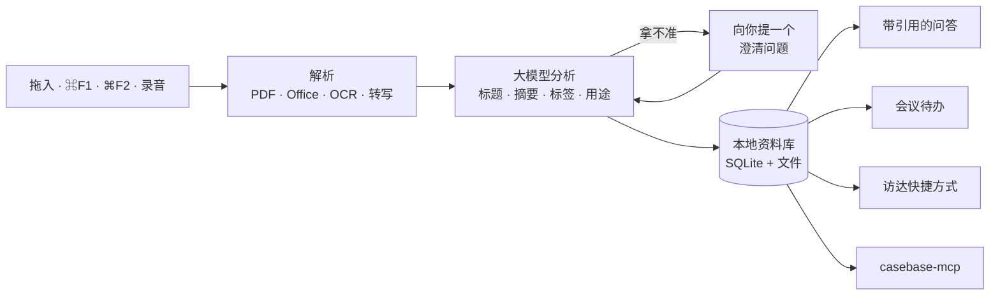

# casebase

[English](README.md)

**随手一存，casebase 帮你读懂、归好类，之后还能直接问它。**

casebase 常驻在 Mac 屏幕顶部的刘海区域。把文件拖进去，对选中文字或屏幕按一下快捷键，或者开一场会议录音。它会弄清楚这份资料是什么、在你的 Mac 上整理好，之后你可以对所有存过的东西提问，回答带出处。

## casebase 能帮你做什么

**资料出现的那一刻就接住它。**
聊天里的文件、网页上的一段话、屏幕上的一张图表，拖到刘海上就行；选中文字按 `⌘F1`，截图按 `⌘F2`。不用切换应用，也不用挑文件夹。

**帮你读懂、帮你归类。**
PDF、Word/Excel/PowerPoint、图片、音频、文本和整个文件夹都能解析，图片会做 OCR。大模型会给每份资料生成标题、摘要、关键片段、标签和用途，再归到对应的文件夹里。拿不准用途时，它会问你一个简短的问题，而不是瞎猜。

**在访达里也能找到。**
每条资料都会在 `~/Documents/Casebase 标签入口/<分类>` 下生成一个快捷方式，并打上访达标签，不打开应用也能按主题翻找。

**基于你自己的资料回答问题。**
提一个问题，casebase 会搜索你的资料库，找出相关段落，给出回答并附上可以点开的引用来源。同一个文件存两次会被识别并合并。

**把会议变成纪要和待办。**
在刘海里开始录音，然后继续干别的。结束后，录音和转写文本保存成同一条记录，会议里提到的行动项会作为待办建议，等你确认后加入。

**推动待办往前走。**
待办支持截止日期和筛选，模糊的任务可以让 casebase 拆成具体的子任务。

**接入你的 AI 工具。**
附带的 `casebase-mcp` 服务让 Claude、Codex 等 MCP 客户端可以搜索你的资料、读写你的待办。

## 它是怎么做到的



- **本地优先。** 数据库（SQLite + 全文检索）和你的文件都存放在 `~/Library/Application Support/casebase`，内容只会发给你自己配置的模型服务。
- **模型。** DeepSeek 负责分析、问答以及图片和 PDF 理解。填了 Google API Key 后会额外用 Gemini 做向量语义检索；不填则使用全文检索。
- **转写。** 会议录音由本地的 oMLX 服务转写，音频不会离开你的 Mac。

## 你只需要做这几步

1. **安装。** 从 [Releases](https://github.com/Raozhu/casebase/releases) 下载 `Casebase-<版本号>-arm64.dmg`，把 `casebase.app` 拖进「应用程序」。应用暂未经过 Apple 公证，第一次打开时到「系统设置 → 隐私与安全性」里点「仍要打开」。
2. **填入 DeepSeek API Key。** 鼠标移到刘海上，打开「设置」，粘贴 Key。
3. **开始存。** 拖一个文件到刘海上，或者试试 `⌘F1` / `⌘F2`。系统弹出权限请求时点允许。

就这些。还可以按需开启：

- 会议转写：在本机运行 oMLX 服务（见[配置](#配置)）。
- 语义检索：在设置里填入 Google API Key。
- AI 工具：从 Releases 下载 `casebase-mcp`，添加到你的 MCP 客户端。

需要 macOS 14 及以上、Apple 芯片的 Mac。

## 日常使用

| 你想 | 这样做 |
|---|---|
| 保存文件、图片、PDF、音频、文件夹 | 拖到刘海上 |
| 保存当前选中的文字 | `⌘F1` |
| 截图并保存 | `⌘F2` |
| 会议录音 | 鼠标移到刘海上 → **录音**，填写人数（默认 2）和主题（可不填） |
| 翻看存过的资料 | 鼠标移到刘海上 → **查看数据** |
| 对所有资料提问 | 鼠标移到刘海上 → **探索** |
| 查看和管理待办 | 鼠标移到刘海上 → **待办** |
| 打开圆桌（可选） | `⌘F4` |

快捷键可以在设置里修改。录音过程中切换到其他功能不会中断。

## 配置

配置保存在 `~/Library/Application Support/casebase/.env`，在应用里填写的 Key 也会写到这里。

| 变量 | 用途 |
|---|---|
| `DEEPSEEK_API_KEY` | 必填。资料分析、问答、图片和 PDF 理解 |
| `CASEBASE_ANALYSIS_MODEL`、`CASEBASE_ANSWER_MODEL` | 模型名，默认 `deepseek-flash` |
| `CASEBASE_GOOGLE_API_KEY` | 选填。启用 Gemini 向量语义检索 |
| `CASEBASE_STORAGE_ROOT` | 选填。资料库存放位置，默认 `~/Library/Application Support/casebase` |

**会议转写**使用本地的 oMLX 服务（兼容 OpenAI 接口，模型 `VibeVoice-ASR-4bit`），配置在 `~/.omlx/settings.json`。没有它也能录音，只是不会生成转写文本。

**圆桌**（`⌘F4`）是可选的配套功能：一个本地多智能体群聊服务，从 `KNIGHTS_HOME` 启动，端口 3721，它产生的记忆会自动导入 casebase。设置 `KNIGHTS_AUTOSTART=0` 可以关闭。

## MCP 服务

`casebase-mcp` 是一个 stdio 方式的 MCP 服务，读取同一个本地资料库。

| 工具 | 作用 |
|---|---|
| `casebase_list_records`、`casebase_search_records`、`casebase_get_record` | 浏览和搜索资料 |
| `casebase_list_todos`、`casebase_get_todo` | 读取待办 |
| `casebase_create_todo`、`casebase_update_todo` | 新建和修改待办 |

```json
{
  "mcpServers": {
    "casebase": { "command": "/path/to/casebase-mcp" }
  }
}
```

## 权限说明

casebase 只在你第一次使用对应功能时请求权限：

- 辅助功能：读取选中文字（`⌘F1`）
- 屏幕录制：截图（`⌘F2`）
- 麦克风：会议录音

## 从源码构建

用 Xcode 16 及以上打开 `casebase.xcodeproj`，运行 `casebase` scheme；`casebase-mcp` scheme 用来构建 MCP 服务。

## 许可证

[GPL-3.0](LICENSE)
